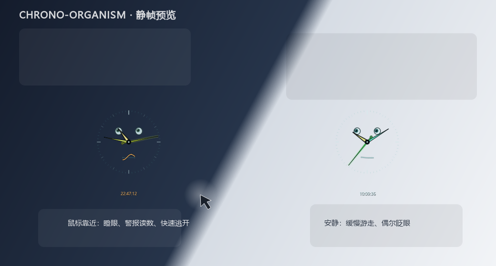

# Chrono-Organism / 时钟生物

桌面上的「观测样本」式时钟生物：**逐像素透明、始终置顶、鼠标穿透、不抢焦点**，
会自己在屏幕里缓慢游走，鼠标靠近时惊慌逃开。三根指针的颜色由它们各自指向的
时刻决定，随时间连续变化。

单文件 PySide6 实现，视觉走科研仪器 / 技术图纸风格：没有机身/度盘边框，也没有
底板填充（alpha 0），只有一圈低对比刻度、三根加粗的指针、一对小眼睛、一条平时
很淡的波形嘴，以及底部一行很小的数字时间。指针是唯一同时做到粗、饱和、带深色
描边的元素，视线会自然落在时间上。



## 运行

```powershell
pip install -r requirements.txt
python clock_creature.py
```

或双击 `run.bat`（用 `pythonw` 启动，不留控制台窗口）。

**退出**：右键系统托盘图标 → **退出**。窗口本身是鼠标穿透的，点不到，也拖不动。
托盘菜单另有「暂停游走」「回到屏幕中央」。

调试时可用 `python clock_creature.py --no-tray`（此时只能在终端 Ctrl+C 退出），
`--size 180` 可指定表盘直径。

## 行为

### 透明、置顶、不干扰

- `FramelessWindowHint` + `WA_TranslucentBackground`：没有矩形窗口底，只画生物本身；
- 盘面完全透明：没有机身/度盘边框，填充 alpha = 0；只靠刻度、深色描边和亮色芯
  保证指针、眼睛在浅色壁纸上也能读；
- Windows 扩展样式补上 `WS_EX_LAYERED | WS_EX_TRANSPARENT | WS_EX_TOOLWINDOW |
  WS_EX_NOACTIVATE`：**点击穿透**、不进任务栏 / Alt+Tab、不抢输入焦点；
- `WindowStaysOnTopHint`：浮在普通窗口上方（独占全屏游戏除外）；
- 窗口收不到鼠标事件，所以「靠近检测」是每帧读取全局光标位置，而不是监听窗口事件。

### 游走与逃跑

速度全部按**屏幕宽度 W** 归一化，换显示器不需要改参数：

| 行为 | 规则 | 1440 px 宽屏上的值 |
|---|---|---|
| 巡航 | `0.028 W × (0.62 ~ 1.0)` px/s | 25 ~ 40 px/s |
| 30 秒路程 | 巡航上限 `0.84 W` | ≤ 1210 px（实测 550 ~ 830 px） |
| 逃跑 | `0.42 W`，夹在 400 ~ 1250 px/s | ~605 px/s |
| 警觉半径 | `2.2 R + max(70, 0.08 W)` | ~310 px |

巡航方向由几条低频正弦叠加成的缓慢转向，转向本身也有惯性；恐慌值上升快、
消退慢，逃跑时额外叠加切向分量，所以不会笔直后退或卡在墙角。

### 指针颜色

指针颜色只落在「蓝 → 青 → 绿 → 琥珀」这段仪器色环上，不出现彩虹色：

| 指针 | 色相映射 | 变化周期 |
|---|---|---|
| 时针 | `210° → 35°`，随 `hour/12` 线性移动 | 12 小时 |
| 分针 | `190° → 35°`，随 `minute/60` | 1 小时 |
| 秒针 | `35° → 190°`，随 `sec/60` | 1 分钟 |

秒数由秒针和底部时间注脚提供；外圈不再保留进度弧，避免形成一圈边框。

### 「活着」的细节

- 每 3~7 秒随机眨眼，闭眼 0.16 秒；
- 眼睛平时看向运动方向，受惊时盯着鼠标（威胁源）；
- 嘴是一条振幅/频率随恐慌值变化的波形线，平时透明度压得很低、接近一条淡线，
  受惊时才明显、变高变快并转琥珀色；
- 秒针每秒有一次很小的回弹，中心轴、针尖有独立的小圆点；
- 整只时钟有 1% 表盘半径的上下浮动和受惊时的轻微颤动；
- 底部只留一行 7 px 的 `HH:MM:SS`：受惊时转琥珀色，暂停时转灰；不再显示速度和模式。

## 科研风格的设计取舍

- **无边框的观测窗**：机身/度盘边框和填充全部去掉（alpha 0），只留刻度、指针和
  很小的脸；视线先落在指针上，再看到眼睛和时间；
- **刻度即信息**：只保留 60 格刻度，12 点略长；不再画极坐标网格、围栏、定位十字，
  避免细线网络和指针抢注意力；
- **单色系 + 一个警示色**：主体是冷青/冰白，只有受惊时出现琥珀色读数、波形和
  紧张的眼神，颜色本身携带状态信息；
- **时间注脚**：底部只留一行 7 px 的等宽 `HH:MM:SS`，无底板、带深色阴影；
  受惊时转琥珀色，不再显示速度和模式；
- **眼睛缩小**：半径 0.078R 的光学孔径，保留眨眼和注视，但不再是大块白色焦点；
- **嘴只在受惊时明显**：平时几乎是一条淡线，受惊时变成高幅高频的琥珀色抖动波形。

## 性能与内存（本机实测）

测试环境：Windows 11、200% 缩放（372×372 设备像素，186×186 逻辑像素）、
逻辑屏宽 1440、表盘直径 130。
复现：

```powershell
python tools/bench_runtime.py --seconds 6
```

| 指标 | 实测 | 说明 |
|---|---|---|
| 帧率 | 23.8 fps 巡航；逃跑时切 60 fps | 加粗描边后把巡航帧率从 30 降到 24 |
| 单帧绘制 | 1.9 ~ 2.0 ms | 只画指针、眼睛、波形、时间 |
| 单核 CPU | 7 ~ 8% | 8 核机器上约占整机 1% |
| 工作集 | 58.5 → 58.7 MB（6 秒） | 峰值 58.7 MB |
| 私有字节 | 25.7 → 25.8 MB | 运行期无增长 |

内存说明：

- 60 MB 工作集主要是 **PySide6/Qt 运行时本身**，不是动画缓存；
- 本程序自己的位图缓存只有一张静态刻度层，200% 缩放下约 0.55 MB；
- 缓存只在启动/窗口尺寸变化时重建（基准里 `builds=1`），每帧不会新建大对象，
  也没有持续增长的列表或历史帧。

如果目标是 20 MB 级别，只能放弃 PySide6，改纯 Win32 + GDI+ 或 tkinter + 分层窗口；
那是另一套实现，功能和可维护性都会变差。当前方案是在「可读、可改、跨平台潜力」
和「内存尽量低」之间的折中。

### 为什么能降下来

旧版 60 fps 全量重绘时单核约 47%。现在：

1. 60 格刻度只画一次，缓存成 `QPixmap`；
2. 每帧只画指针、眼睛、波形嘴、时间行；
3. 巡航 24 fps，只有 `panic > 0.15` 的短暂逃跑期切到 60 fps；
4. 速度/尺寸都用屏幕宽度归一化，不随分辨率反复分配资源。

删掉网格、触须/纤毛和大号读数后，单帧降到约 1.9 ms；
巡航维持 24 fps（约 7~8% 单核），逃跑仍是 60 fps。

## 实现要点

- **穿透与不抢焦点**：`Qt.WindowTransparentForInput` + 原生 `WS_EX_TRANSPARENT`，
  再补 `WS_EX_NOACTIVATE`；托盘菜单是独立窗口，不受影响。
- **鼠标感知**：主窗口收不到事件，因此用 `QCursor.pos()` 每帧取全局坐标；
  这也是「鼠标穿透但仍会躲鼠标」能同时成立的原因。
- **静态缓存**：`_build_background()` 在首帧和 `resizeEvent` 后各执行一次；
  设备像素比通过 `QPixmap.setDevicePixelRatio()` 处理，200% 缩放下线条仍然清晰。
- **速度预算**：巡航速度上限 `0.028 W`，30 秒最多 `0.84 W`；边界反弹只会缩短路程。
  基准脚本 `tools/bench_runtime.py` 用 900 步模拟 30 秒并断言不超过一个屏宽。

## 可调参数

都在 `clock_creature.py` 顶部，改完直接重启：

| 常量 | 默认 | 作用 |
|---|---|---|
| `ROAM_FRACTION` | `0.028` | 巡航速度 / 屏宽 |
| `FLEE_FRACTION` | `0.42` | 逃跑速度 / 屏宽 |
| `FLEE_MAX` | `1250` | 逃跑速度上限（px/s） |
| `FLEE_ZONE_R` / `FLEE_ZONE_SCREEN` | `2.2` / `0.08` | 警觉半径 |
| `DIAMETER_FRACTION` | `0.13` | 表盘直径 / 屏幕短边 |
| `GLASS_CENTER_ALPHA` / `GLASS_EDGE_ALPHA` | `0` / `0` | 机身玻璃底透明度；默认完全透明 |
| `DIAL_ALPHA` | `0` | 度盘填充透明度；默认完全透明 |
| `READOUT_ALPHA` | `0` | 时间注脚底板透明度；0 = 只剩带阴影的文字 |
| `CALM_FRAME_MS` / `PANIC_FRAME_MS` | `42` / `16` | 巡航 / 逃跑帧间隔 |

## 文件

```
Clock/
├─ clock_creature.py       主程序（物理 + 渲染 + 托盘）
├─ run.bat                 无控制台启动
├─ requirements.txt        PySide6
├─ docs/preview.png        静帧预览（tools/preview.py 生成）
└─ tools/
   ├─ preview.py           离屏渲染安静/逃跑两态，不需要显示窗口
   └─ bench_runtime.py     运动预算 + 逃跑响应 + CPU/内存基准
```

## 已知边界

- 在 Windows 11 上实测；Qt 的穿透/置顶在 macOS/Linux 上未验证；
- 托盘图标是唯一的退出入口；若系统托盘被禁用，需在终端 Ctrl+C；
- 不记忆位置、不自动开机启动、没有设置界面（参数在源码顶部）；
- 只在启动时所在的那块屏幕活动，不会跨显示器；
- 机身/度盘默认就是完全透明（alpha 0）；若在浅色或花壁纸上觉得细刻度太淡，可把
  `GLASS_CENTER_ALPHA` / `GLASS_EDGE_ALPHA` 调到 18/36、`DIAL_ALPHA` 调到 4；
- 时间注脚默认无底板，用深色阴影 + 亮字保证可读；需要更稳的对比度时把
  `READOUT_ALPHA` 调到 140，会恢复一块很淡的小底板；
- 独占全屏游戏 / 某些全屏应用会盖住置顶窗口；
- 表盘是鼠标穿透的，无法拖动；需要移动请用托盘「回到屏幕中央」再等它游走。

---

AI 生成（2026-10-25）。性能数字为单机实测，换机器/缩放比例会变化；
PySide6 内存基线请以自己机器上的 `tools/bench_runtime.py` 输出为准。
